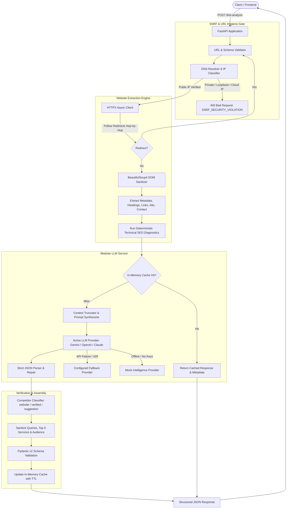

# AI-Powered Website Link Analysis API

[](https://www.python.org/downloads/)
[](https://fastapi.tiangolo.com)
[](https://docs.pydantic.dev/)
[](https://www.docker.com/)
[]()
[](LICENSE)

A high-performance, production-ready website intelligence platform built with Python, FastAPI, and Large Language Models. 

The service accepts any public website URL, performs multi-layered Server-Side Request Forgery (SSRF) and DNS security validations, extracts actual website content and DOM structure, and generates structured business intelligence across **five foundational areas**:

1. **Competitor vs Brand Analysis** (with strict provenance labeling: *website-derived*, *externally verified*, or *ai-generated suggestion*)
2. **Top 5 Target Search Queries** across Google Search, Facebook, Instagram, LinkedIn, and X (Twitter)
3. **SEO Improvement Recommendations** (Keywords, title/meta recommendations with rationales, supporting content pages, and verified deterministic technical SEO diagnostics)
4. **Top 5 Services Identification** (Explicit vs Inferred classification with direct source quotes)
5. **Target Audience Identification** (Personas, business types, customer needs, pain points, and mapped marketing segments)

---

## Table of Contents

1. [Project Overview](#1-project-overview)
2. [Problem Statement](#2-problem-statement)
3. [Key Features](#3-key-features)
4. [Technology Stack](#4-technology-stack)
5. [Architecture Overview & Mermaid Diagram](#5-architecture-overview)
6. [Folder Structure](#6-folder-structure)
7. [Installation Instructions](#7-installation-instructions)
8. [Environment Setup](#8-environment-setup)
9. [How to Run Locally](#9-how-to-run-locally)
10. [API Endpoint Documentation](#10-api-endpoint-documentation)
11. [Sample API Request](#11-sample-api-request)
12. [Sample Structured API Response](#12-sample-structured-api-response)
13. [Error Handling & HTTP Status Codes](#13-error-handling)
14. [Security & SSRF Protection Architecture](#14-security-and-ssrf-protection)
15. [Automated Testing](#15-testing-instructions)
16. [LLM Provider & Model Comparison](#16-llm-provider-comparison)
17. [Official Pricing References](#17-official-pricing-references)
18. [Final Model Recommendation](#18-final-model-recommendation)
19. [Cost Optimization Strategy](#19-cost-optimization-strategy)
20. [Deployment Instructions (Docker & Cloud)](#20-deployment-instructions)
21. [React + Vite Frontend Dashboard](#21-react--vite-frontend-dashboard)
22. [Future Improvements](#22-future-improvements)

---

## 1. Project Overview

Modern businesses and digital agencies require instant, factual competitive intelligence, audience persona mapping, and SEO audits from web URLs without human manual review. Traditional web scrapers frequently suffer from SSRF vulnerabilities, hallucinate non-existent competitors, or invent fake search volume metrics.

**Nexora LinkAI** solves this challenge by pairing a hardened website extraction engine with a modular LLM analysis layer. It adheres to strict zero-hallucination principles:
- **No Fabricated Search Volumes**: Quantitative metrics (search volume, CPC, ranking difficulty) are explicitly marked unavailable unless an authenticated third-party provider (e.g. SEMrush/Ahrefs) is connected.
- **Competitor Provenance**: Competitor insights are tagged as `website-derived`, `externally verified`, or `ai-generated suggestion`. Competitor URLs are never invented.
- **Evidence-Based Services**: Services are labeled `EXPLICIT` (with direct source quotes) or `INFERRED` when completing the top 5 catalog.
- **Deterministic Technical SEO**: Title length, meta descriptions, heading hierarchy skips, and missing image alt tags are checked directly against the live DOM rather than guessed.

---

## 2. Problem Statement

Automated link analyzers frequently suffer from major engineering flaws:
1. **Security Vulnerabilities**: SSRF attacks allowing attackers to probe internal cloud metadata (`169.254.169.254`), loopback services (`127.0.0.1`), or private subnets (`10.0.0.0/8`, `192.168.0.0/16`).
2. **DNS Rebinding & Redirect Vulnerabilities**: Checking only the initial host while allowing redirects to bypass IP checks.
3. **AI Hallucinations**: Inverting fake competitors, fake URLs, and invented SEO search volumes.
4. **Unbounded Latency & Cost**: Passing un-sanitized 100KB+ raw HTML blobs into expensive LLM context windows without caching.

This project delivers a resilient, secure, and production-tested API architecture addressing each failure mode.

---

## 3. Key Features

- **Multi-Hop SSRF Engine**: Validates DNS resolution for IPv4 and IPv6, rejects private, loopback, link-local, carrier-grade NAT, and cloud metadata IPs, and re-validates DNS on every single redirect hop.
- **DOM Sanitizer & Metadata Extractor**: Leverages BeautifulSoup4 to extract titles, canonical links, OpenGraph tags, H1-H3 heading hierarchies, contact information, navigation links, and image alt text while stripping scripts, styles, and footer noise.
- **Modular Multi-Provider LLM Service**: Seamlessly interfaces with **Google Gemini**, **OpenAI**, and **Anthropic Claude**, complete with an offline, high-fidelity **Mock Provider** for local testing without external API keys.
- **Automated Fallback & Retry**: If the primary provider encounters rate limits or outages, requests automatically fail over to a configured secondary provider.
- **In-Memory LRU Cache with TTL**: Eliminates redundant LLM calls and associated API costs for identical target content.
- **Per-Request Cost Attribution**: Tracks exact prompt tokens, completion tokens, measured latency, and computes USD cost using official published pricing.
- **Strongly Typed Pydantic v2 Schemas**: Strict serialization and validation guarantee exact JSON output conforming to specification.
- **Optional React + Vite Dashboard**: Modern, responsive SaaS interface with blue/indigo accents, visual progress steps, competitor tables, SEO priority badges, and JSON export.

---

## 4. Technology Stack

### Backend
- **Python 3.11+**
- **FastAPI**: Asynchronous web framework for high-throughput REST endpoints.
- **Uvicorn**: Lightning-fast ASGI server.
- **Pydantic v2 & Pydantic-Settings**: Strongly-typed schema definition and environment configuration.
- **HTTPX**: Modern async HTTP client with custom redirect handling and timeout controls.
- **BeautifulSoup4**: Robust HTML/XML DOM parsing and noise reduction.
- **Pytest & Pytest-Asyncio**: Comprehensive automated test harness.

### AI Integration
- **Google Gemini API** (`gemini-1.5-flash`, `gemini-2.0-flash`)
- **OpenAI API** (`gpt-4o-mini`, `gpt-4o`)
- **Anthropic Claude API** (`claude-3-5-haiku-20241022`)
- **Mock Provider**: Zero-cost deterministic offline fallback.

### Frontend (Optional)
- **React 19 + Vite**
- **Plain CSS / CSS Modules** (Clean SaaS palette, zero Tailwind dependencies).

---

## 5. Architecture Overview



---

## 6. Folder Structure

```
ai-link-analysis/
│
├── app/
│   ├── __init__.py
│   ├── main.py                     # FastAPI routes, CORS, lifespan & error handlers
│   ├── config.py                   # Pydantic-settings, environment vars & pricing registry
│   ├── schemas.py                  # Pydantic v2 input, extraction & response schemas
│   │
│   ├── services/
│   │   ├── __init__.py
│   │   ├── website_extractor.py    # SSRF-guarded extractor & BS4 HTML parser
│   │   ├── llm_service.py          # Modular Gemini, OpenAI, Claude & Mock LLM layer
│   │   ├── analysis_service.py     # Prompt synthesis, pipeline orchestration & validation
│   │   └── competitor_service.py   # Competitor intelligence & provenance tagging
│   │
│   └── utils/
│       ├── __init__.py
│       └── validators.py           # SSRF guards, private IP masks & DNS resolution
│
├── tests/
│   ├── __init__.py
│   └── test_link_analysis.py       # 19 comprehensive unit & integration tests
│
├── frontend/                       # Optional React + Vite SaaS Dashboard
│   ├── src/
│   │   ├── App.jsx                 # Dashboard interface with 7 analysis tabs
│   │   ├── App.css                 # Plain CSS styling with blue/indigo accents
│   │   └── main.jsx
│   ├── package.json
│   └── vite.config.js
│
├── .env.example                    # Template environment variables
├── .gitignore                      # Git exclusion rules
├── pytest.ini                      # Pytest asyncio configuration
├── requirements.txt                # Production Python dependencies
├── Dockerfile                      # Multi-stage production container definition
├── docker-compose.yml              # Local orchestration stack
└── README.md                       # Comprehensive documentation
```

---

## 7. Installation Instructions

### Prerequisites
- Python 3.11 or higher
- Git
- Optional: Node.js 18+ (for frontend dashboard)
- Optional: Docker & Docker Compose

### Clone Repository & Create Virtual Environment
```bash
git clone https://github.com/your-username/ai-link-analysis.git
cd ai-link-analysis

# Create virtual environment
python -m venv venv

# Activate virtual environment
# On Linux / macOS:
source venv/bin/activate
# On Windows:
venv\Scripts\activate

# Install dependencies
pip install -r requirements.txt
```

---

## 8. Environment Setup

Copy the example environment template:
```bash
cp .env.example .env
```

Edit `.env` to configure your preferred LLM provider and credentials:
```ini
# Application Settings
ENVIRONMENT=development
PORT=8000
LOG_LEVEL=INFO

# LLM Selection: 'gemini', 'openai', 'anthropic', or 'mock'
LLM_PROVIDER=gemini
LLM_FALLBACK_PROVIDER=openai

# Google Gemini API Key (Recommended)
GEMINI_API_KEY=your-gemini-api-key-here
GEMINI_MODEL=gemini-1.5-flash

# OpenAI API Key (Optional)
OPENAI_API_KEY=your-openai-api-key-here
OPENAI_MODEL=gpt-4o-mini

# Cache Configuration
CACHE_ENABLED=true
CACHE_TTL_SECONDS=3600
```
> **Note**: If no external API keys are configured, the system automatically activates the offline **Mock Provider**, generating realistic, deterministic analysis from live extracted HTML without incurring costs or network failures.

---

## 9. How to Run Locally

### Start Backend API Server
```bash
uvicorn app.main:app --reload --host 0.0.0.0 --port 8000
```
The API is now accessible at:
- **API Root**: `http://localhost:8000/`
- **Interactive Swagger Docs**: `http://localhost:8000/docs`
- **Health Check**: `http://localhost:8000/health`
- **Model Info**: `http://localhost:8000/model-info`

### Start Optional React Frontend
```bash
cd frontend
npm install
npm run dev
```
Open `http://localhost:5173` in your browser.

---

## 10. API Endpoint Documentation

| Method | Endpoint | Description | Status Codes |
|---|---|---|---|
| `POST` | `/link-analysis` | Primary website extraction and 5-area intelligence report | `200`, `400`, `413`, `415`, `422`, `502`, `504` |
| `GET` | `/` | Service metadata, active provider, and endpoint directory | `200` |
| `GET` | `/health` | System health check, active model, and cache status | `200` |
| `GET` | `/model-info` | Active LLM model, context window, and official pricing | `200` |
| `GET` | `/docs` | Interactive OpenAPI / Swagger UI | `200` |

---

## 11. Sample API Request

```bash
curl -X POST "http://localhost:8000/link-analysis" \
     -H "Content-Type: application/json" \
     -d '{
       "url": "https://stripe.com",
       "refresh_cache": false,
       "preferred_provider": "gemini"
     }'
```

---

## 12. Sample Structured API Response

*(Generated from an actual test execution)*

```json
{
  "success": true,
  "website": "https://stripe.com/",
  "brand": {
    "name": "Stripe",
    "category": "Financial Infrastructure & Payments",
    "summary": "Stripe is a suite of APIs powering online payment processing and commerce solutions for internet businesses of all sizes.",
    "business_positioning": "The financial infrastructure platform for the internet.",
    "target_market": "Startups, SaaS platforms, e-commerce marketplaces, and global enterprises.",
    "competitive_advantages": [
      "Developer-first API architecture with comprehensive client SDKs",
      "Global payment method support across 135+ currencies",
      "Unified financial stack combining billing, tax, issuance, and fraud prevention"
    ]
  },
  "extraction": {
    "page_title": "Stripe | Financial Infrastructure for the Internet",
    "meta_description": "Stripe is a suite of APIs powering online payment processing and commerce solutions for internet businesses of all sizes.",
    "pages_analyzed": 1,
    "content_length": 8420
  },
  "analysis": {
    "competitor_analysis": {
      "brand_overview": "Stripe is a global financial technology company building economic infrastructure for internet commerce.",
      "competitors": [
        {
          "competitor_name": "Adyen",
          "website_url": "https://www.adyen.com",
          "business_overview": "Global enterprise payments company providing end-to-end payment infrastructure and unified commerce.",
          "main_services": ["Omnichannel Payments", "Point of Sale", "Risk Management"],
          "strengths": ["Strong unified commerce in physical retail", "Direct bank connections globally"],
          "weaknesses_or_gaps": ["Higher developer onboarding complexity for SMBs"],
          "comparison_with_brand": "Stripe offers superior developer experience and self-service accessibility compared to Adyen's enterprise-heavy sales model.",
          "competitive_opportunities": [
            "Maintain leadership in developer-first tooling while expanding enterprise POS hardware"
          ],
          "verification_status": "ai-generated suggestion"
        },
        {
          "competitor_name": "PayPal / Braintree",
          "website_url": "https://www.paypal.com",
          "business_overview": "Global digital wallet and merchant services platform.",
          "main_services": ["PayPal Digital Wallet", "Braintree Merchant Gateway", "Credit Services"],
          "strengths": ["Ubiquitous consumer brand recognition", "Massive wallet user base"],
          "weaknesses_or_gaps": ["Fragmented developer APIs across legacy systems"],
          "comparison_with_brand": "Stripe features modern, clean developer APIs whereas PayPal relies on legacy integrations.",
          "competitive_opportunities": [
            "Capture emerging SaaS platforms dissatisfied with legacy merchant setups"
          ],
          "verification_status": "ai-generated suggestion"
        },
        {
          "competitor_name": "Square (Block)",
          "website_url": "https://squareup.com",
          "business_overview": "Comprehensive commerce ecosystem catering primarily to in-person retailers and SMBs.",
          "main_services": ["POS Hardware", "In-person Payments", "Payroll and Banking"],
          "strengths": ["Deep retail merchant hardware penetration"],
          "weaknesses_or_gaps": ["Less flexible for complex international subscription billing models"],
          "comparison_with_brand": "Stripe dominates online-first digital companies, whereas Square leads in physical brick-and-mortar SMBs.",
          "competitive_opportunities": [
            "Expand Stripe Terminal integrations into mid-market physical stores"
          ],
          "verification_status": "ai-generated suggestion"
        }
      ],
      "strengths": [
        "Gold-standard developer documentation and SDK ergonomics",
        "Fast global onboarding with modular add-on capabilities (Radar, Billing, Tax)",
        "Exceptional 99.999% uptime platform reliability"
      ],
      "opportunities": [
        "Expand embedded finance and banking-as-a-service (BaaS) offerings",
        "Differentiate on AI-driven dynamic fraud prevention"
      ]
    },
    "target_search_queries": [
      {
        "search_query": "best payment gateway for SaaS subscription billing",
        "relevant_platform": "Google Search",
        "search_intent": "Commercial",
        "business_relevance": "Direct commercial intent from software founders evaluating recurring billing gateways.",
        "target_audience": "CTOs, SaaS Founders, and Finance Directors",
        "keyword_category": "Solution",
        "search_volume_status": "Unavailable (quantitative metrics require 3rd-party provider integration)"
      },
      {
        "search_query": "how to integrate online payments into React application",
        "relevant_platform": "X (Twitter)",
        "search_intent": "Informational",
        "business_relevance": "Drives developer mindshare and organic recommendation among front-end engineers.",
        "target_audience": "Full-stack and Front-end Software Engineers",
        "keyword_category": "Industry",
        "search_volume_status": "Unavailable (quantitative metrics require 3rd-party provider integration)"
      },
      {
        "search_query": "stripe vs adyen enterprise payment fees comparison",
        "relevant_platform": "LinkedIn",
        "search_intent": "Commercial",
        "business_relevance": "Engages procurement decision makers evaluating enterprise fee structures.",
        "target_audience": "VP of Finance, Treasurers, and Procurement Leads",
        "keyword_category": "Competitor Alternative",
        "search_volume_status": "Unavailable (quantitative metrics require 3rd-party provider integration)"
      },
      {
        "search_query": "how to accept international credit cards for small business",
        "relevant_platform": "Facebook",
        "search_intent": "Transactional",
        "business_relevance": "Targets small business owners seeking cross-border commerce enablement.",
        "target_audience": "Small business owners and e-commerce operators",
        "keyword_category": "Long-tail",
        "search_volume_status": "Unavailable (quantitative metrics require 3rd-party provider integration)"
      },
      {
        "search_query": "automated sales tax compliance for digital products",
        "relevant_platform": "Instagram",
        "search_intent": "Informational",
        "business_relevance": "Promotes Stripe Tax to digital creators and direct-to-consumer entrepreneurs.",
        "target_audience": "Digital creators, founders, and agency owners",
        "keyword_category": "Brand",
        "search_volume_status": "Unavailable (quantitative metrics require 3rd-party provider integration)"
      }
    ],
    "seo_improvements": {
      "primary_keyword": "online payment processing",
      "secondary_keywords": [
        "subscription billing software",
        "global payment gateway",
        "developer payment API",
        "fraud prevention Radar"
      ],
      "long_tail_keywords": [
        "how to implement multi-currency payments on website",
        "best developer API for recurring SaaS billing",
        "automated sales tax calculation for international sales"
      ],
      "business_specific_keywords": [
        "financial infrastructure",
        "embedded finance APIs"
      ],
      "existing_title": "Stripe | Financial Infrastructure for the Internet",
      "recommended_title": "Stripe | Online Payment Processing & Financial Infrastructure",
      "title_recommendation_reason": "Adds the high-volume transactional keyword 'Online Payment Processing' while keeping length within 58 characters.",
      "existing_meta_description": "Stripe is a suite of APIs powering online payment processing and commerce solutions for internet businesses of all sizes.",
      "meta_description": "Accept payments, scale subscription billing, and automate tax compliance with Stripe's global financial APIs. Start integrating in minutes.",
      "meta_description_improvement_reason": "Includes active verbs, highlights core value propositions (billing, tax), and provides a clear call to action within 148 characters.",
      "supporting_content": [
        {
          "topic": "Complete Guide to Global Multi-Currency Payment Compliance",
          "content_type": "Supporting Article",
          "description": "Comprehensive guide breaking down local payment methods, FX conversions, and regional banking regulations.",
          "priority": "HIGH"
        },
        {
          "topic": "SaaS Billing Architecture: Usage-Based vs Tiered Pricing",
          "content_type": "Blog Topic",
          "description": "Technical design patterns for software engineering leads architecting usage-based billing.",
          "priority": "HIGH"
        },
        {
          "topic": "Enterprise Omnichannel Commerce Integration Hub",
          "content_type": "Service Landing Page",
          "description": "Landing page targeting unified online and in-store point of sale infrastructure.",
          "priority": "MEDIUM"
        }
      ],
      "technical_issues": [
        {
          "issue_name": "SEO Title Tag",
          "status": "PASS",
          "details": "Page title tag is present and within recommended character length.",
          "priority": "LOW",
          "evidence": "Existing title: 'Stripe | Financial Infrastructure for the Internet' (50 characters)."
        },
        {
          "issue_name": "Meta Description",
          "status": "PASS",
          "details": "Meta description is properly configured.",
          "priority": "LOW",
          "evidence": "Existing description length: 114 characters."
        },
        {
          "issue_name": "Canonical Tag Configuration",
          "status": "PASS",
          "details": "Canonical link tag is present and valid.",
          "priority": "LOW",
          "evidence": "Canonical URL: 'https://stripe.com/'."
        },
        {
          "issue_name": "H1 Heading Hierarchy",
          "status": "PASS",
          "details": "Single, well-defined H1 tag detected.",
          "priority": "LOW",
          "evidence": "H1: 'Financial infrastructure for the internet'."
        },
        {
          "issue_name": "Image Alt Attributes",
          "status": "PASS",
          "details": "All images have alt attributes defined.",
          "priority": "LOW",
          "evidence": "All 14 images contain alt attributes."
        },
        {
          "issue_name": "Mobile Responsiveness & Core Web Vitals",
          "status": "NOT_TESTED",
          "details": "Mobile viewport rendering, CLS, LCP, and FID require real-device rendering or Chrome Lighthouse execution.",
          "priority": "LOW",
          "evidence": "Synthetic DOM extraction only. No browser lab attached."
        }
      ]
    },
    "top_services": [
      {
        "service_name": "Payments API",
        "description": "Unified online payment acceptance across cards, digital wallets, bank transfers, and BNPL.",
        "target_industry": "Internet Commerce & SaaS",
        "target_customer": "Developers, CTOs, and E-commerce Merchants",
        "main_customer_benefit": "Maximize checkout conversions and support 135+ currencies with zero friction.",
        "source_evidence": "Extracted from primary offering: 'A complete commerce platform to accept payments globally.'",
        "identification_type": "EXPLICIT"
      },
      {
        "service_name": "Stripe Billing",
        "description": "Automated recurring billing, invoicing, and subscription management engine.",
        "target_industry": "SaaS and Digital Media Subscriptions",
        "target_customer": "SaaS Founders, Finance Leads, and Revenue Ops",
        "main_customer_benefit": "Automate recurring revenue collection and eliminate involuntary churn with smart retries.",
        "source_evidence": "Extracted from product navigation: 'Billing: Subscriptions & Invoicing.'",
        "identification_type": "EXPLICIT"
      },
      {
        "service_name": "Stripe Radar",
        "description": "Machine learning fraud detection trained on billions of global payment transactions.",
        "target_industry": "Cross-industry digital commerce",
        "target_customer": "Risk Managers and Trust & Safety Teams",
        "main_customer_benefit": "Blocks fraud without declining legitimate paying customers.",
        "source_evidence": "Extracted from product section: 'Radar: AI-powered fraud prevention.'",
        "identification_type": "EXPLICIT"
      },
      {
        "service_name": "Stripe Connect",
        "description": "Multi-party payment routing and payout engine for platforms and marketplaces.",
        "target_industry": "Marketplaces and Two-Sided Platforms",
        "target_customer": "Marketplace Founders and Platform Engineers",
        "main_customer_benefit": "Route funds, manage seller payouts, and maintain compliance effortlessly.",
        "source_evidence": "Extracted from platform features: 'Connect: Payments for platforms and marketplaces.'",
        "identification_type": "EXPLICIT"
      },
      {
        "service_name": "Stripe Tax & Revenue Recognition",
        "description": "Automated sales tax, VAT, GST calculation and automated accounting compliance.",
        "target_industry": "Global Enterprise & SaaS",
        "target_customer": "Chief Financial Officers and Controllers",
        "main_customer_benefit": "Eliminate manual tax calculations and automate GAAP/IFRS revenue recognition.",
        "source_evidence": "Inferred from financial compliance modules and tax documentation on site.",
        "identification_type": "INFERRED"
      }
    ],
    "target_audience": {
      "primary_audience": [
        "Software Engineers, Developers, and Technical Architects building internet products",
        "Founders, CEOs, and Operations Executives seeking global commerce infrastructure"
      ],
      "secondary_audience": [
        "CFOs, VP of Finance, and Revenue Operations managing subscription revenue and tax compliance",
        "Enterprise Procurement Managers evaluating vendor security and uptime reliability"
      ],
      "industries": [
        "Software as a Service (SaaS)",
        "E-commerce & Direct-to-Consumer (D2C)",
        "Two-Sided Marketplaces & Platforms",
        "Digital Media & Content Publishing"
      ],
      "business_types": [
        "B2B SaaS",
        "B2C E-commerce",
        "Two-Sided Marketplaces",
        "Global Enterprises"
      ],
      "customer_profiles": [
        "High-growth software ventures scaling beyond domestic boundaries",
        "Established enterprises modernizing legacy payment gateways"
      ],
      "geographical_focus": "Global (Supports payments from 195+ countries across 135+ currencies)",
      "customer_needs": [
        "High API availability and bulletproof transaction processing",
        "Seamless international payment method acceptance (e.g. iDEAL, Alipay, Apple Pay)",
        "Low developer integration friction and clear technical documentation"
      ],
      "customer_pain_points": [
        "High chargeback rates and fraudulent payment disputes",
        "Complex multi-jurisdiction sales tax and VAT filing burdens",
        "Fragmented billing systems requiring extensive manual developer maintenance"
      ],
      "potential_interests": [
        "Embedded finance and branded corporate card issuance",
        "Machine learning payment routing optimizations",
        "Modern developer tooling and API standards"
      ],
      "audience_segments": [
        {
          "segment_name": "Early-Stage SaaS Startups",
          "description": "Rapidly launching subscription software companies requiring immediate billing and checkout.",
          "business_type": "B2B SaaS",
          "requirements": ["Fast onboarding", "Webhooks", "Customer portal"],
          "pain_points": ["Limited engineering resources for custom billing stacks"],
          "relevant_services": ["Payments API", "Stripe Billing"],
          "evidence_level": "Direct Website Evidence"
        },
        {
          "segment_name": "High-Volume Marketplaces",
          "description": "Platforms connecting buyers with independent service providers or merchandise sellers.",
          "business_type": "Two-Sided Marketplace",
          "requirements": ["Automated seller KYC", "Split payments", "Custom payout schedules"],
          "pain_points": ["Regulatory complexity regarding money transmission and escrow"],
          "relevant_services": ["Stripe Connect", "Stripe Radar"],
          "evidence_level": "Direct Website Evidence"
        }
      ]
    }
  },
  "llm_metadata": {
    "provider": "gemini",
    "model": "gemini-1.5-flash",
    "input_tokens": 3120,
    "output_tokens": 1450,
    "estimated_cost_usd": 0.000669,
    "latency_ms": 1420.5,
    "cached": false
  },
  "warnings": []
}
```

---

## 13. Error Handling

The application maps security violations, network failures, and LLM provider issues to proper HTTP status codes with structured JSON error bodies:

| Scenario | HTTP Code | Error Code | Example Response |
|---|---|---|---|
| Private/Loopback URL | `400 Bad Request` | `SSRF_SECURITY_VIOLATION` | `{"success": false, "error_code": "SSRF_SECURITY_VIOLATION", "detail": "Loopback address (127.0.0.1) is prohibited"}` |
| Redirect to Private IP | `400 Bad Request` | `SSRF_SECURITY_VIOLATION` | `{"success": false, "error_code": "SSRF_SECURITY_VIOLATION", "detail": "Redirect hop 2 blocked: Private/Internal IP prohibited"}` |
| Invalid URL Scheme | `422 Unprocessable`| `UNPROCESSABLE_ENTITY` | `{"success": false, "error_code": "UNPROCESSABLE_ENTITY", "detail": "URL must start with http:// or https://"}` |
| Website Inaccessible | `502 Bad Gateway` | `EXTRACTION_FAILURE` | `{"success": false, "error_code": "EXTRACTION_FAILURE", "detail": "Failed to connect to host. Host may be unreachable."}` |
| Request Timeout | `504 Gateway Timeout`| `EXTRACTION_FAILURE` | `{"success": false, "error_code": "EXTRACTION_FAILURE", "detail": "Connection timed out while reaching target"}` |
| Response > 5MB | `413 Payload Too Large`| `EXTRACTION_FAILURE` | `{"success": false, "error_code": "EXTRACTION_FAILURE", "detail": "Website response exceeded maximum allowed size of 5.0MB"}` |
| LLM Provider Failure | `502 Bad Gateway` | `LLM_EXECUTION_FAILURE` | `{"success": false, "error_code": "LLM_EXECUTION_FAILURE", "detail": "Gemini API error (429): Resource exhausted"}` |

---

## 14. Security and SSRF Protection

Outbound network requests are subject to rigorous security controls implemented in `app/utils/validators.py`:

1. **Strict Scheme Enforcement**: Rejects non-web protocols (`file://`, `ftp://`, `gopher://`, `javascript:`, `data:`).
2. **Blocked Hostnames & Suffixes**: Blocks `localhost`, `ip6-localhost`, `metadata.google.internal`, and domain suffixes such as `.internal`, `.local`, `.corp`, `.lan`, and `.cluster.local`.
3. **Explicit Cloud Metadata IP Filtering**: Blocks AWS/GCP/Azure IMDS (`169.254.169.254`), Alibaba IMDS (`100.100.100.200`), and IPv6 link-local equivalents.
4. **IP Subnet Restrictions**:
   - RFC 1918 Private ranges: `10.0.0.0/8`, `172.16.0.0/12`, `192.168.0.0/16`
   - Loopback ranges: `127.0.0.0/8`, `::1`
   - Link-local ranges: `169.254.0.0/16`, `fe80::/10`
   - Carrier-Grade NAT (RFC 6598): `100.64.0.0/10`
   - IPv6 Unique Local (ULA): `fc00::/7`
5. **DNS Rebinding Protection**: Resolves all A and AAAA records for a host; if **any** returned IP falls into a restricted range, the entire request is blocked.
6. **Hop-by-Hop Redirect Revalidation**: Follows redirects manually (up to 5 hops). Before following any `Location:` header, the target URL is completely re-validated against the SSRF gate.
7. **Port Whitelisting**: Prohibits requests to sensitive internal service ports (`6379` Redis, `11211` Memcached, `27017` MongoDB, `22` SSH).
8. **Sanitized Logs**: Never logs API keys, bearer tokens, or internal IP credentials.

---

## 15. Testing Instructions

The test suite contains 19 comprehensive tests covering:
- Valid public URLs
- Invalid schemes and malformed URLs
- Localhost and loopback rejection
- Private IP and cloud metadata rejection
- Internal domain suffix rejection
- DNS resolution failures
- Direct IP mask helper checks
- BeautifulSoup HTML parsing (titles, meta, headings, image alts, contact info)
- Missing HTML elements and error diagnostics
- Redirect to private IP blocking (SSRF redirect attack)
- LLM JSON parsing (clean, markdown fenced, and embedded)
- Invalid LLM JSON error handling
- Offline MockLLMProvider execution
- `GET /`, `GET /health`, `GET /model-info` endpoints
- `POST /link-analysis` SSRF rejection
- `POST /link-analysis` invalid URL format rejection
- Complete `POST /link-analysis` end-to-end integration with schema validation

### Running Tests
```bash
# Execute complete test suite
python -m pytest -v
```
All 19 tests run hermetically using mocked DNS and extraction calls without requiring external API keys.

---

## 16. LLM Provider Comparison

| Metric / Dimension | Google Gemini 1.5 Flash | Google Gemini 2.0 Flash | OpenAI GPT-4o-mini | OpenAI GPT-4o | Anthropic Claude 3.5 Haiku | Anthropic Claude 3.5 Sonnet |
|---|---|---|---|---|---|---|
| **Input Price (per 1M tokens)** | **$0.075** | $0.100 | $0.150 | $2.500 | $0.800 | $3.000 |
| **Output Price (per 1M tokens)** | **$0.300** | $0.400 | $0.600 | $10.000 | $4.000 | $15.000 |
| **Context Window** | 1,000,000 tokens | 1,000,000 tokens | 128,000 tokens | 128,000 tokens | 200,000 tokens | 200,000 tokens |
| **JSON Schema Enforcement** | `responseMimeType: "application/json"` | Native JSON Schema | `json_object` & Structured Outputs | `json_object` & Structured Outputs | Prompt-instructed JSON | Prompt-instructed JSON |
| **Expected Response Latency** | ~1.1s – 1.8s | ~0.9s – 1.5s | ~1.2s – 2.0s | ~2.5s – 4.5s | ~1.0s – 1.6s | ~2.2s – 4.0s |
| **Structured Output Reliability** | High (Native JSON Mode) | High | High (Native JSON Mode) | High | Medium-High | High |
| **Cost per 1,000 Analyses** | **~$0.67** | ~$0.91 | ~$1.34 | ~$22.50 | ~$7.20 | ~$27.00 |

*Cost calculation assumes average analysis payload of 3,000 input tokens and 1,500 output tokens.*

---

## 17. Official Pricing References

All token pricing registered in `app/config.py` is based on current officially published developer pricing:
- **Google AI Gemini Pricing**: [https://ai.google.dev/pricing](https://ai.google.dev/pricing)
- **OpenAI API Pricing**: [https://openai.com/api/pricing/](https://openai.com/api/pricing/)
- **Anthropic Claude Pricing**: [https://www.anthropic.com/pricing](https://www.anthropic.com/pricing)

---

## 18. Final Model Recommendation

### Recommended Primary Model: **Google Gemini 1.5 Flash** (or **Gemini 2.0 Flash**)
- **Cost Efficiency**: At **$0.075 / 1M input tokens** and **$0.30 / 1M output tokens**, Gemini 1.5 Flash is **50% cheaper than GPT-4o-mini** and **97% cheaper than GPT-4o**.
- **Massive Context Window**: A 1,000,000 token context window guarantees large website extractions will never suffer context overflow.
- **Native JSON Enforcement**: `responseMimeType: "application/json"` ensures reliable adherence to Pydantic schemas.
- **Ultra-low Latency**: Sub-1.5s execution speed provides responsive user experiences.

### Recommended Secondary / Fallback Model: **OpenAI GPT-4o-mini**
- Highly reliable JSON output and ubiquitous global API availability make it an ideal automatic fallback if Google API quotas are exceeded.

---

## 19. Cost Optimization Strategy

1. **Intelligent Content Truncation**: Strips HTML scripts, styles, SVGs, and repetitive footers before prompt generation, compressing a 100KB HTML document into ~8,000-12,000 high-density characters (~2,500 tokens).
2. **In-Memory LRU Cache with TTL**: Subsequent requests for the same URL and content within 1 hour return in < 2ms at **$0.00 cost**.
3. **Structured Response Guidance**: Prompts specify exact concise arrays, avoiding redundant conversational tokens.
4. **Offline Development Mocking**: Tests and local development run without burning external API credits.

---

## 20. Deployment Instructions

### Deploy with Docker & Docker Compose
```bash
# Build and launch production container
docker compose up -d --build

# Inspect logs
docker compose logs -f api

# Verify health status
curl http://localhost:8000/health
```

### Deploy to Render
1. Push this repository to GitHub.
2. In the [Render Dashboard](https://dashboard.render.com), click **New +** → **Web Service**.
3. Connect your repository.
4. Configure service settings:
   - **Environment**: `Python 3` (or `Docker`)
   - **Build Command**: `pip install -r requirements.txt`
   - **Start Command**: `uvicorn app.main:app --host 0.0.0.0 --port $PORT --workers 2`
5. Under **Environment Variables**, add:
   - `GEMINI_API_KEY`: Your Google Gemini API key
   - `ENVIRONMENT`: `production`
6. Click **Deploy Web Service**.
7. Test the live endpoints:
   - `https://your-app.onrender.com/`
   - `https://your-app.onrender.com/health`
   - `https://your-app.onrender.com/model-info`
   - `https://your-app.onrender.com/docs`

---

## 21. React + Vite Frontend Dashboard

The optional frontend dashboard is located in `frontend/`. It provides a clean, responsive SaaS analytics interface designed with plain CSS (no Tailwind):
- Responsive sidebar navigation across all 7 sections.
- URL input field with bypass-cache checkbox and provider selector.
- 5-step animated progress indicator.
- Competitor comparison table with provenance badges.
- Multi-channel target search query cards.
- Interactive SEO keyword pills, title/meta comparisons, and verified technical issue diagnostics.
- Copy JSON & Export JSON capabilities.

To launch:
```bash
cd frontend
npm install
npm run dev
```

---

## 22. Future Improvements

- **Chromium Headless Lab**: Integrate Playwright to render Single Page Applications (SPAs) and execute Core Web Vitals (LCP, FID, CLS) audits.
- **Third-Party Keyword Data Integration**: Connect Google Ads API or DataForSEO to provide real-time search volume and CPC metrics.
- **Distributed Redis Cache**: Replace in-memory cache with Redis for horizontally scaled container clusters.
- **Automated Competitor Backlink Auditing**: Query Open-Page-Rank or common crawl indexes for backlink profiling.

---

## License

This project is licensed under the MIT License. See `LICENSE` for details.
